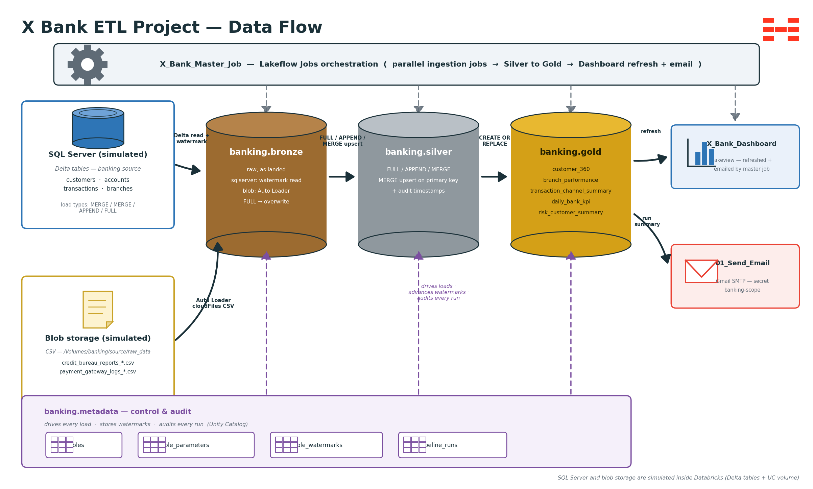

# X Bank ETL Project

A banking data engineering project on Databricks that ingests data from two simulated
source systems, lands it in a **Bronze** layer, cleans and deduplicates it into
**Silver**, and builds analytical **Gold** marts — all orchestrated by **metadata tables**
that decide what to load, how to load it, and in what order, with a full audit trail,
email notification, and a Lakeview dashboard at the end of every run.

## What This Project Does

- Ingests 6 banking source tables: customers, accounts, transactions, branches (simulated
  SQL Server — Delta tables in `banking.source`) and credit_bureau_reports,
  payment_gateway_logs (simulated blob storage — CSV files in UC volume
  `/Volumes/banking/source/raw_data`).
- Loads each table into Bronze using a per-table strategy driven entirely by metadata:
  FULL (snapshot overwrite), APPEND (incremental insert), or MERGE (upsert on primary key
  with watermark-based incremental filtering).
- Promotes Bronze to Silver with the same load-type rules, adds audit columns, manages
  high-water marks, and writes run-level audit entries (status, record counts, errors).
- Builds 5 Gold analytical marts — customer_360, branch_performance,
  transaction_channel_summary, daily_bank_kpi, risk_customer_summary — via a generic
  driver notebook that dispatches to one transformation notebook per table.
- Sends an HTML summary email of the whole run (per-table status, records, errors) via
  Gmail SMTP using a secret stored in the `banking-scope` secret scope.
- Refreshes the X_Bank_Dashboard (Lakeview) and emails it to subscribers.

## Project Architecture

All data lives in the `banking` Unity Catalog catalog — there is no external SQL Server
or blob storage; both source systems are simulated inside Databricks.

| Schema | Purpose |
| --- | --- |
| `banking.source` | Simulated sources — Delta tables (sqlserver) and CSV files in volume `banking.source.raw_data` (blob) |
| `banking.bronze` | Raw ingested data as landed from source |
| `banking.silver` | Cleaned/conformed data, loaded per load type (FULL / APPEND / MERGE) |
| `banking.gold` | Analytical marts rebuilt from silver on every run |
| `banking.metadata` | Control tables driving and auditing the pipeline |

### Metadata (control) tables

| Table | Role |
| --- | --- |
| `banking.metadata.tables` | Registry of every table: source system, source location, target schemas, active flag, load order |
| `banking.metadata.table_parameters` | Per-table load configuration: `load_type`, `primary_key`, `watermark_column` |
| `banking.metadata.table_watermarks` | High-water mark per table for incremental (APPEND/MERGE) loads |
| `banking.metadata.pipeline_runs` | Audit trail: run_id, table_id, layer, start/end time, status, record count, error message |

### Repository structure

```
X_Bank_ETL_Project/
├── README.md                   # This file
├── images/
│   └── dataflow.png                # Data flow architecture diagram (see Data Flow below)
├── X_Bank_Dashboard.lvdash.json    # Lakeview dashboard over gold marts
├── banking_etl_project/        # The notebooks (development workspace)
│   ├── 00_Source_Files/
│   │   ├── 01_source_system_ddl        # Creates banking.source Delta tables (SQL Server simulation)
│   │   └── 02_Insert_Historical_data  # Parses a .sql INSERT script into source tables + loads CSVs into the volume
│   ├── 01_Setup_Metadata/
│   │   └── 01_Setup_Metadata           # Creates banking.metadata tables; seeds registry, parameters, watermarks
│   ├── 02_Source_to_Silver/
│   │   ├── 00_Setup_Secret_Scope       # Creates secret scope 'banking-scope' for Gmail credentials
│   │   ├── 01_Read_Tables_list         # Reads active tables for a source_system from metadata, ordered by load_order; sets task value
│   │   ├── 02_Read_Table_Parameters    # Reads load config (load_type / primary_key / watermark) per table
│   │   ├── 03_Source_to_Bronze         # Ingests source → banking.bronze.<table> (Delta read + watermark, or Auto Loader for CSVs)
│   │   └── 04_Bronze_to_Silver         # Promotes bronze → banking.silver.<table> (FULL / APPEND / MERGE) + watermark & audit updates
│   ├── 03_Silver_to_Gold/
│   │   ├── 01_Silver_to_Gold_Driver     # Audit entry → runs the right transformation notebook → updates audit
│   │   └── gold_transformations/        # One notebook per gold mart
│   ├── 04_Email_Notification/
│   │   └── 01_Send_Email                # pipeline_runs summary for run_id → HTML email via Gmail SMTP
│   └── Data_Queries                     # Ad-hoc queries / exploration
└── jobs_code/                   # Job definitions (YAML, Databricks resource format)
    ├── X_Bank_Master_Job.yaml           # Master job: end-to-end orchestration
    ├── X_Bank_Source_to_Silver.yaml     # Outer ingestion job (For Each over tables)
    ├── X_Bank_Source_to_Silver_Inner_Job.yaml  # Inner per-table job: parameters → bronze → silver
    └── X_Bank_Silver_to_Gold.yaml       # Gold job (For Each over gold tables)
```

## Data Flow



*(SQL Server and blob storage are simulated inside Databricks — Delta tables in `banking.source` and CSV files in the `raw_data` UC volume.)*

### Step by step

1. **Source simulation (00_Source_Files)** — the DDL notebook creates the `banking.source`
   Delta tables; the historical-data notebook parses an INSERT script into those tables,
   and the CSVs land in the `raw_data` volume.
2. **Setup (01_Setup_Metadata)** — control tables are created and seeded with the 6 source
   tables + 5 gold tables, their load parameters, and initial watermarks (1900-01-01).
3. **Ingestion job (X_Bank_Source_to_Silver)** — `01_Read_Tables_list` reads active tables
   for the given `source_system` ordered by `load_order` and publishes them as a task
   value; a **For Each** task fans out one Inner job per table.
4. **Inner job (per table)** — `02_Read_Table_Parameters` fetches the load config, then
   `03_Source_to_Bronze` ingests into `banking.bronze.<table>` and `04_Bronze_to_Silver`
   promotes it into `banking.silver.<table>`, updating watermarks and the audit table in a
   `finally` block.
5. **Gold job (X_Bank_Silver_to_Gold)** — a For Each over the gold tables runs
   `01_Silver_to_Gold_Driver`, which records a Gold audit entry and executes
   `gold_transformations/<table_name>` via `dbutils.notebook.run`; each mart is rebuilt
   with `CREATE OR REPLACE TABLE` (full refresh from silver).
6. **Notification & dashboard** — `01_Send_Email` reads `pipeline_runs` for the `run_id`,
   computes overall SUCCESS/FAILED, renders an HTML status table, and sends it via Gmail
   SMTP using `dbutils.secrets.get(scope="banking-scope", key="gmail_api_key")`. The
   master job then refreshes and emails the X_Bank_Dashboard snapshot.

### Job orchestration (X_Bank_Master_Job)

| Task | Depends on | What it does |
| --- | --- | --- |
| Source_to_Silver_Blob | — | Runs X_Bank_Source_to_Silver with `source_system = blob` |
| Source_to_Silver_SqlServer | — | Runs X_Bank_Source_to_Silver with `source_system = sqlserver` (parallel) |
| Silver_to_Gold | both ingestion tasks (ALL_DONE) | Runs X_Bank_Silver_to_Gold |
| X_Bank_Dashboard_Refresh | Silver_to_Gold | Refreshes the dashboard and emails the snapshot |

## Table Inventory & Load Types

| Table | Source | load_type | Primary key / watermark |
| --- | --- | --- | --- |
| customers | sqlserver (Delta) | MERGE | customer_id / updated_at |
| accounts | sqlserver (Delta) | MERGE | account_id / updated_at |
| transactions | sqlserver (Delta) | APPEND | txn_id / transaction_date |
| branches | sqlserver (Delta) | FULL | branch_code (full snapshot) |
| credit_bureau_reports | blob (CSV volume) | MERGE | customer_id / bureau_pull_date |
| payment_gateway_logs | blob (CSV volume) | APPEND | txn_id / transaction_date |

Gold marts (all rebuilt from silver on every run): `customer_360`, `branch_performance`,
`transaction_channel_summary`, `daily_bank_kpi`, `risk_customer_summary`.

## Key Implementation Notes

- **Metadata-driven**: adding a new table requires only new rows in
  `banking.metadata.tables` and `table_parameters` — no notebook code changes.
- **Widgets pass context between notebooks**: `run_id`, `table_metadata`,
  `table_parameters` are passed as job/notebook parameters; `01_Read_Tables_list` publishes
  the table list as a job task value consumed by the For Each tasks.
- **Column DEFAULTs workaround**: source Delta tables define column DEFAULTs, so bronze
  and silver tables are pre-created via `CREATE TABLE ... TBLPROPERTIES
  ('delta.feature.allowColumnDefaults'='supported') AS SELECT ... WHERE 1=0` before
  appending, avoiding `WRONG_COLUMN_DEFAULTS_FOR_DELTA_FEATURE_NOT_ENABLED`.
- **Incremental loads** filter on `watermark_column > last_watermark` (stored in
  `table_watermarks`), and the watermark is advanced to the max processed value after
  each successful load.
- **Audit everywhere**: every layer writes start/end time, status, record count, and
  error message to `banking.metadata.pipeline_runs`, keyed by `run_id` + `table_id`.
